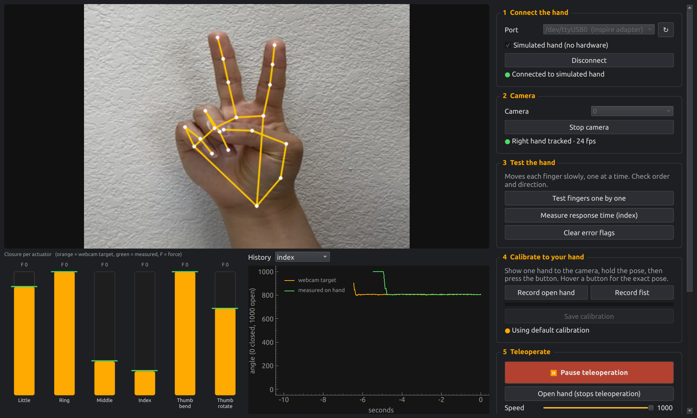
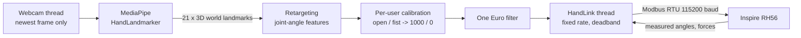

# inspire-hand-teleop

[](https://github.com/Airuxn/inspire-hand-teleop/actions/workflows/ci.yml)

[](LICENSE)

Real-time teleoperation of the **Inspire RH56** dexterous hand from an ordinary webcam:
MediaPipe hand tracking, retargeting of 21 human hand landmarks onto the hand's 6 actuators,
One Euro filtering, and a low-latency Modbus RTU driver. Includes a desktop app for
connecting, testing, calibrating and teleoperating the hand.


<sub>The app in simulated-hand mode, fed with a MediaPipe sample image. Orange bars: target
from the webcam. Green lines: angle measured on the hand.</sub>

## Status

Tested on a physical Inspire RH56 over a CH340 RS485 adapter: communication, finger tests and
webcam teleoperation work. Modbus latency is measured (below); actuator dynamics and
end-to-end latency are next. See the [changelog](CHANGELOG.md).

## Why

Teleoperation is how most robot-learning datasets are collected: a human demonstrates, the
robot mirrors, and the (observation, action) pairs become training data for imitation
learning and vision-language-action models. This repo is the first stage of that pipeline for
a dexterous humanoid hand — the same hand family used on the Unitree G1.

## Features

- **Webcam teleoperation** at up to 60 Hz command rate, with no gloves or markers.
- **Geometric retargeting** from 3D hand landmarks to the hand's 6 actuators, with a
  two-pose calibration per user.
- **Low-latency driver**: about 5 ms per Modbus request instead of a fixed 200 ms wait.
- **Desktop app** with live target-vs-measured bars and a history plot, plus a command-line
  interface for scripting.
- **Hardware tests**: per-finger motion test, step-response measurement, error and
  temperature readout.
- **Simulated hand** that runs the real driver over an emulated serial port, so everything
  works without hardware and is covered by tests.
- **CSV logging** of targets, measured angles and forces for analysis and system
  identification.

## Install

Requires Linux, Python 3.10+ and [uv](https://docs.astral.sh/uv/).

```bash
git clone https://github.com/Airuxn/inspire-hand-teleop
cd inspire-hand-teleop
uv sync
```

Optional: install the app with a launcher in the application menu and on the desktop.

```bash
scripts/install_desktop.sh              # or --editable to run from this checkout
```

The MediaPipe hand model (~8 MB) is downloaded to `~/.cache/inspire-hand-teleop/` on first
run. Serial access requires membership of the `dialout` group. Wiring, power and register
details are in [docs/hardware.md](docs/hardware.md).

## Usage

### App

```bash
uv run inspire-teleop app
```

The sidebar walks through five steps:

1. **Connect the hand.** The CH340 adapter is preselected; tick *Simulated hand* to try
   everything without hardware.
2. **Camera.** Starts automatically and shows which hand is tracked.
3. **Test the hand.** Moves each finger in turn (slow, low force), measures the step response,
   and clears error flags.
4. **Calibrate.** Record an open hand and a fist. Actuators whose two poses look too similar
   keep their previous calibration instead of amplifying tracking noise. Calibration is stored
   in `~/.config/inspire-hand-teleop/calibration.json`.
5. **Teleoperate.** Start/pause, open the hand, adjust speed, grip force and smoothing, and
   optionally log to CSV.

### Command line

```bash
inspire-teleop ports                      # list serial ports, mark the CH340 adapter
inspire-teleop check                      # read-only: id, angles, forces, temperatures, errors
inspire-teleop wiggle                     # move each actuator in turn (slow, low force)
inspire-teleop step --finger index        # step response: dead time, rise time -> CSV
inspire-teleop calibrate                  # record open hand + fist from the webcam
inspire-teleop run                        # teleoperate in a minimal keyboard-driven window
inspire-teleop run --mock                 # same, with a simulated hand
inspire-teleop run --log run.csv --record demo.mp4
```

Keys in the `run` window: `space` pause/resume (the hand holds its pose), `o` open hand,
`r` reset filter, `q`/`esc` quit (the hand opens on exit). If the tracked hand leaves the
image, the robot hand holds its last pose.

Per-actuator values always follow the hand's order:
`little, ring, middle, index, thumb_bend, thumb_rotate`.

## How it works



**Retargeting.** Each actuator gets one geometric feature from the 3D world landmarks:

| Actuator | Feature |
|---|---|
| little, ring, middle, index | MCP flexion (sideways spread removed) + PIP flexion; DIP is mechanically coupled on the hand |
| thumb bend | thumb MCP bend + IP bend |
| thumb rotate | elevation of the thumb (CMC → IP) out of the palm plane |

A two-pose calibration maps each feature linearly onto the hand's 0 (closed) … 1000 (open)
range, so different users and camera setups work without tuning.

**Driver.** Each response is read by its exact expected length and its CRC is verified, so a
request takes as long as the serial transfer and the hand's reply, not a fixed delay. The
hand link runs on its own thread at a fixed rate: vision never blocks on serial I/O, and the
hand always receives the newest target.

**Session.** `TeleopSession` owns the camera, tracker, filter and hand link on a worker
thread. The Qt app and the command-line window are thin front ends over it.

## Measurements

Inspire RH56 over a CH340 RS485 adapter at 115200 baud, 200 requests each:

| Request | Median | p95 |
|---|---|---|
| Read 6 measured angles | 4.55 ms | 4.65 ms |
| Write 6 target angles | 4.92 ms | 4.99 ms |

Next: actuator dead time and rise time (`inspire-teleop step`) and camera-to-motion latency.
Details and method in [docs/hardware.md](docs/hardware.md#measurements).

## Project layout

```
inspire_teleop/
  driver.py      Modbus RTU client and InspireHand API
  sim_serial.py  emulated hand for --mock and tests
  tracking.py    webcam capture and MediaPipe hand landmarks
  retarget.py    landmarks -> actuator features, calibration
  filters.py     One Euro filter
  link.py        fixed-rate hand link thread with CSV logging
  session.py     camera -> tracking -> retargeting -> hand pipeline
  routines.py    finger test and step response
  app.py         Qt desktop app
  teleop.py      minimal OpenCV window for `run` and `calibrate`
  cli.py         `inspire-teleop` command line
tests/           driver, retargeting, filter and session tests (no hardware needed)
docs/            hardware notes and images
```

## Development

```bash
uv sync
uv run pytest
uv run ruff check . && uv run ruff format --check .
```

CI runs the same checks on Python 3.10, 3.12 and 3.13.

## Roadmap

- [x] Webcam teleoperation with calibration and filtering
- [x] Desktop app and hardware test routines
- [x] Tested on a physical RH56; Modbus latency measured
- [ ] Actuator step response and end-to-end latency measurements
- [ ] Force sensor zero calibration and grasp detection
- [ ] MuJoCo digital twin of the hand, with actuator parameters fitted to measured step
      responses (system identification) and a sim-vs-real comparison
- [ ] Record teleoperated demonstrations (camera + actions) and train imitation-learning /
      VLA grasp policies
- [ ] RL grasping in simulation, transferred to the physical hand

## Acknowledgements

- [MediaPipe Hand Landmarker](https://ai.google.dev/edge/mediapipe/solutions/vision/hand_landmarker)
  for hand tracking; the screenshot uses one of its sample images.
- Register addresses as documented in
  [Sentdex/inspire_hands](https://github.com/Sentdex/inspire_hands).
- G. Casiez, N. Roussel, D. Vogel, *1€ Filter*, CHI 2012.

## License

[MIT](LICENSE)
