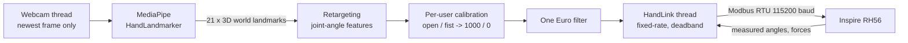

# inspire-hand-teleop

Real-time teleoperation of the **Inspire RH56** dexterous hand from an ordinary webcam:
MediaPipe hand tracking, retargeting of 21 human hand landmarks onto the hand's 6 actuators,
One Euro filtering, and a low-latency Modbus RTU driver.

> **Status:** software complete and tested against a simulated hand (`--mock`).
> First hardware session pending — measured latencies will be added below.

## Why

Teleoperation is how most robot-learning datasets are collected: a human demonstrates, the
robot mirrors, and the (observation, action) pairs become training data for imitation learning
and vision-language-action models. This repo is the first stage of that pipeline for a
dexterous humanoid hand — the same hand family used on the Unitree G1.

## How it works



**Retargeting.** Each actuator gets one geometric feature from the 3D world landmarks:

| Actuator | Feature |
|---|---|
| little, ring, middle, index | MCP flexion (sideways spread removed) + PIP flexion; DIP is mechanically coupled on the hand |
| thumb bend | thumb MCP bend + IP bend |
| thumb rotate | elevation of the thumb (CMC → IP) out of the palm plane |

A two-pose calibration (open hand, fist) maps each feature linearly onto the hand's
0 (closed) … 1000 (open) range, so different users and camera setups work without tuning.

**Driver.** The commonly used Python driver waits a fixed 200 ms after every command, which
caps control at ~5 Hz. `inspire_teleop.driver` reads each response by its exact expected
length and verifies the CRC, so a write/read round trip is bounded by the serial transfer and
the hand's reply time. The control link runs on its own thread so vision never blocks on I/O
and the hand always receives the newest target.

**Session.** `inspire_teleop.session.TeleopSession` owns the camera, tracker, filter and hand
link on a worker thread; the Qt app and the command-line window are thin front ends over it.

**Mock mode.** `--mock` runs the real Modbus driver against an in-process emulation of the
hand's registers with rate-limited actuator dynamics, so the full pipeline can be developed and
tested without hardware.

## Install

```bash
git clone https://github.com/Airuxn/inspire-hand-teleop
cd inspire-hand-teleop
uv sync            # or: pip install -e .
```

The MediaPipe hand model (~8 MB) is downloaded to `~/.cache/inspire-hand-teleop/` on first run.

Linux serial access: your user must be in the `dialout` group, and `brltty` must not be
installed (it claims CH340 adapters on Ubuntu).

## Usage

### App

```bash
uv run inspire-teleop app
scripts/install_desktop.sh      # optional: install + launcher in the app menu and on the desktop
```

Calibration is stored in `~/.config/inspire-hand-teleop/calibration.json`.

One window with the camera view, per-actuator bars (webcam target vs. measured on the hand),
a live history plot, and numbered steps in the sidebar:

1. **Connect the hand** — the CH340 adapter is preselected; tick *Simulated hand* to try
   everything without hardware.
2. **Camera** — starts automatically; shows which hand is tracked and the frame rate.
3. **Test the hand** — move each finger in turn (slow, low force), measure the step response,
   clear error flags.
4. **Calibrate** — record an open hand and a fist; actuators whose two poses look too similar
   keep their previous calibration instead of amplifying tracking noise.
5. **Teleoperate** — start/pause, open hand, speed, grip force and smoothing sliders, optional
   CSV logging.

### Command line

```bash
inspire-teleop ports                      # find the CH340 adapter
inspire-teleop check                      # id, angles, forces, temperatures, error flags
inspire-teleop wiggle                     # move each actuator in turn (slow, low force)
inspire-teleop calibrate                  # record open hand + fist from the webcam
inspire-teleop run                        # teleoperate in a minimal keyboard-driven window
inspire-teleop run --mock                 # same, with a simulated hand
inspire-teleop run --log run.csv --record demo.mp4
inspire-teleop step --finger index        # step response: dead time, rise time
```

Keys in the `run` window: `space` pause/resume (hand holds its pose), `o` open hand,
`r` reset filter, `q`/`esc` quit (the hand opens on exit).
If the tracked hand leaves the image, the robot hand holds its last pose.

All per-finger values follow the hand's actuator order:
`little, ring, middle, index, thumb_bend, thumb_rotate`.

## Measurements

To be filled in from the first hardware session (`inspire-teleop step`, `run --log`):

| Metric | Value |
|---|---|
| Modbus write round trip | – |
| Actuator dead time (step) | – |
| Actuator 10–90 % rise time | – |
| Camera frame → command sent | – |

## Roadmap

1. **Teleoperation** (this repo) — webcam → hand in real time.
2. **Digital twin + system identification** — fit a MuJoCo actuator model of the hand to the
   step responses recorded with `inspire-teleop step`, and report the sim-vs-real error.
3. **Policy learning** — record teleoperated grasp demonstrations with camera images and
   train imitation-learning / VLA policies; train RL grasping in simulation and transfer it to
   the physical hand.

## License

MIT
